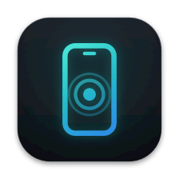
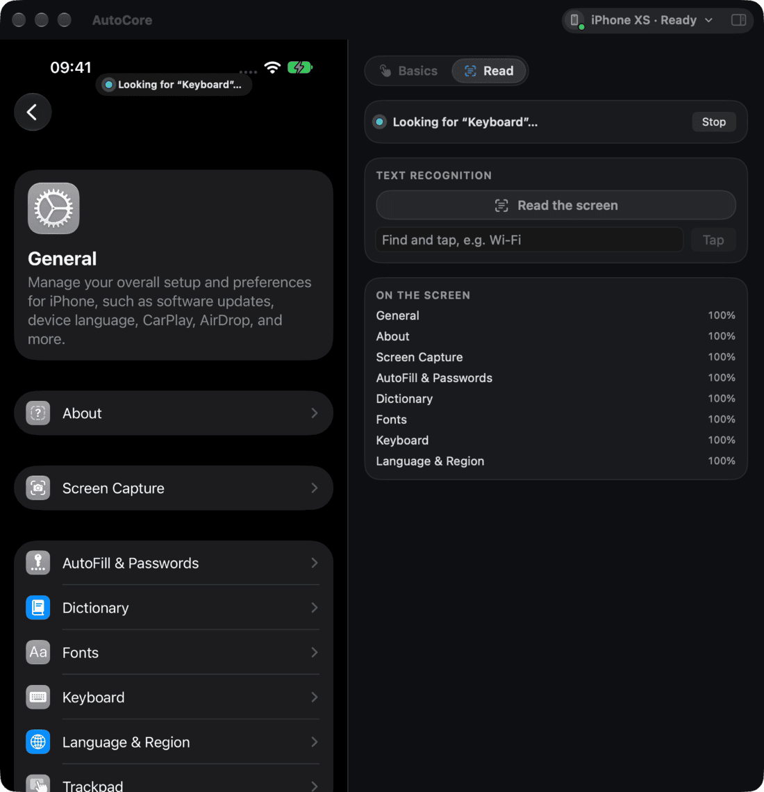
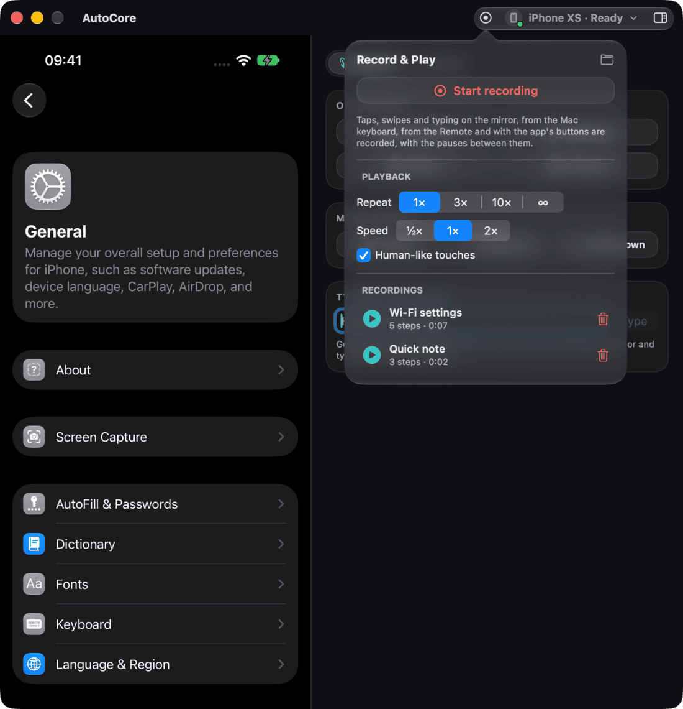
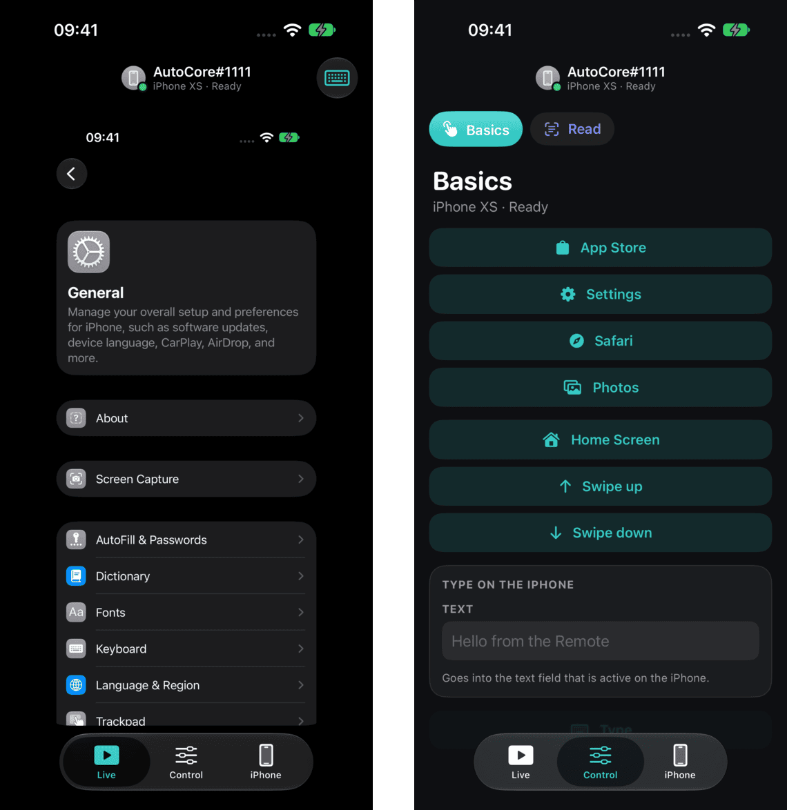
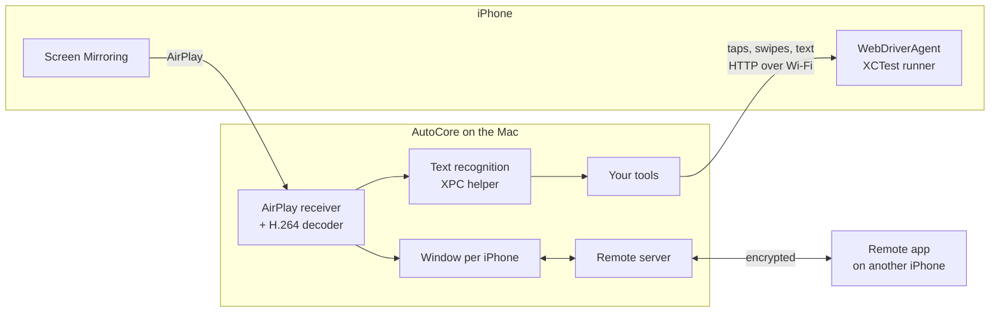
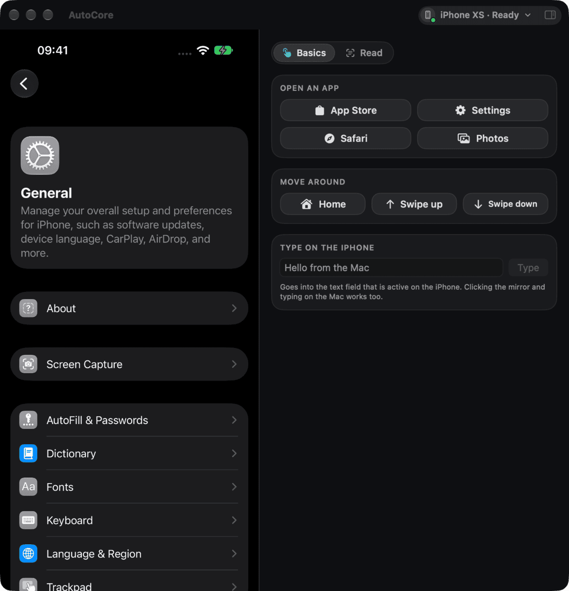

<div align="center">



# AutoCore

**Mirror an iPhone on your Mac, control it with clicks, typing and scripts,
and build your own iPhone automation app on top.**

[](https://github.com/davidkrammer/AutoCore/actions/workflows/ci.yml)
[](LICENSE)




</div>

AutoCore turns your Mac into a remote control for a real iPhone. The iPhone's
screen shows in a Mac window through AirPlay. You click and type on it, and
your own tools tap, swipe, type and read the screen for you. An iPhone app,
the Remote, does all of that from anywhere in your Wi‑Fi.

It is also a starting point: an app built on AutoCore adds only its own
tools (tabs, buttons, automations). Mirroring, touch control, text
recognition, windows and the Remote come from here.

## Features

- **Mirroring without extra hardware.** A built-in AirPlay receiver shows the
  iPhone in a Mac window. Choose your iPhone and press **Connect**: AutoCore
  opens Control Center on the iPhone and picks this Mac by itself. After a
  restart it reconnects on its own.
- **Touch control over Wi‑Fi.** Taps, swipes and typing go through
  [WebDriverAgent](https://github.com/appium/WebDriverAgent), Apple's XCTest
  on the iPhone. Click or drag the mirror to control the iPhone; after a
  click, your Mac keyboard types on it. Automated touches vary a little, like
  a finger's.
- **Reads the screen.** Apple's Vision recognises the text on the mirrored
  screen, with positions, so a tool can find a button by its label and tap
  it. It runs in a helper process that rebuilds itself if macOS deletes its
  model files.
- **Record & Play.** Press record, then use the iPhone as usual: taps and
  swipes on the mirror, Mac keyboard typing, the Remote and the app's
  buttons are recorded with the pauses between them. Play a recording once,
  several times or until you stop it, at ½×, 1× or 2× speed, from the Mac
  or the Remote.
- **More than one iPhone.** One window per iPhone; two run side by side.
  Hide the panel (⌃⌘S) to see only the iPhone.
- **The Remote for iPhone.** The live picture, every tab and its settings,
  and taps and typing, on another iPhone. Pairing needs the same 6-digit code
  on both screens and an OK on the Mac; after that everything is end-to-end
  encrypted (X25519 key agreement, ChaCha20-Poly1305). The Mac describes
  every page, so new tools need no Remote update.
- **English and German.**

## Record & Play

<div align="center">

</div>

The record button in the title bar starts a recording (or ⌥⌘R). While it
records, a bar over the mirror shows the steps so far, with **Save** and
**Discard**. Saved recordings are in the same menu, with **Play**, and on the
Remote's iPhone page. With **Human-like touches** on, each tap lands a few
points off and a moment later, like a finger; off, it plays exactly as
recorded. Recordings are JSON files in
`~/Library/Application Support/AutoCore/recordings/`, easy to share or edit.

## The Remote

<div align="center">

</div>

The **AutoCoreRemote** scheme builds it. On the Mac, open the account menu ›
**AutoCore Remote…** and allow it; on the iPhone, choose your Mac and compare
the codes. The Remote works on the same Wi‑Fi as the Mac.

## How it works



AutoCore talks only to your iPhones and your Remote on the local network. It
has no accounts, no server and no analytics.

## Requirements

- A Mac with macOS 14 or newer, and Xcode 26 or newer
- [XcodeGen](https://github.com/yonaskolb/XcodeGen): `brew install xcodegen`
- An Apple developer team, to sign WebDriverAgent for your iPhones
- An iPhone with **Developer Mode** on, paired with the Mac in Xcode's
  Device Hub (Devices and Simulators in older Xcode). On iOS 27 pairing
  works over Wi‑Fi; older iOS needs a cable once.
- For the Remote: an iPhone with iOS 26 or newer on the same Wi‑Fi

## Getting started

```sh
git clone https://github.com/davidkrammer/AutoCore.git
cd AutoCore

# 1. Your Apple team and bundle ID prefix (this file is not committed)
cp Config/Local.xcconfig.example Config/Local.xcconfig
open -e Config/Local.xcconfig

# 2. Build and sign WebDriverAgent, the touch-control runner
scripts/build-wda.sh <TEAM_ID> <bundle ID prefix>

# 3. Generate the Xcode project and open it
xcodegen generate
open AutoCore.xcodeproj
```

Run the **AutoCore** scheme. In the window, choose your iPhone and press
**Connect**; the iPhone has to be unlocked. The first time takes a minute
while the runner installs. If iOS says the developer is not trusted, allow it
under Settings › General › VPN & Device Management.

`scripts/build-wda.sh` puts `WebDriverAgentProducts.zip` and
`WebDriverAgentSource.zip` into `Resources/`. The app installs the runner on
each iPhone you connect, and signs it again by itself for an iPhone that the
first build didn't cover.

## Try the demo

AutoCore's own app comes with two tabs that show what the core can do:

<div align="center">

</div>

- **Basics:** open App Store, Settings, Safari or Photos; go to the Home
  Screen; swipe up or down; type text into the iPhone's active text field.
- **Read:** read all text on the screen, or find a word and tap it.

The same tools are on the Remote, and in the menu bar under **Automation**
(⌘1 App Store, ⌘2 Home, ⌘R read, ⌘. stop). `Demo/DemoTools.swift` is a small,
complete example of an app's tools.

## Build your own app on AutoCore

An app on AutoCore is AutoCore's sources plus a few files of its own.

**1. Add AutoCore to your repository**

```sh
git submodule add https://github.com/davidkrammer/AutoCore.git Core
```

**2. Compile it into your Mac app** (XcodeGen)

```yaml
targets:
  MyApp:
    type: application
    platform: macOS
    sources:
      - path: MyApp                      # your AppBrand, Tools and panels
        excludes: ["**/Localizable.strings"]
      - path: Core/Sources
      - path: Core/Shared
      - path: Core/VisionService/VisionServiceProtocol.swift
    settings:
      base:
        SWIFT_OBJC_BRIDGING_HEADER: Core/Sources/AirPlay/AutoCore-Bridging-Header.h
    dependencies:
      - target: MyAppVision              # xpc-service from Core/VisionService,
                                         # bundle ID "<your app's ID>.vision"
    postBuildScripts:
      - name: Merge strings
        script: '"$SRCROOT/Core/scripts/merge-strings.sh" "$SRCROOT/Core/Resources" "$SRCROOT/MyApp"'
        basedOnDependencyAnalysis: false
```

This repository's `project.yml` is a complete example, with the Remote and
the tests. List `_<yourapp>-remote._tcp` under `NSBonjourServices` in both
apps' Info.plist; the Remote finds only Macs that run your app.

**3. Say who your app is and what it adds**

```swift
import SwiftUI

@main
struct MyApp: App {
    var body: some Scene { AppScene() }
}

extension AppBrand {
    static let current = AppBrand(name: "MyApp",
                                  // the iPhone app your tools work in, or nil
                                  targetBundleIdentifier: "com.example.someapp")
}

@MainActor
final class Tools: ObservableObject, WindowTools {
    unowned let model: AppModel
    init(model: AppModel) { self.model = model }
    // tabs, panels, Remote pages, what runs and how to stop it …
}
```

`WindowTools` (`Sources/App/AppTools.swift`) lists everything an app
provides, each with a short explanation. Inside your tools, the window's
`model` controls the iPhone:

| Call | Does |
| --- | --- |
| `try await model.tap(point)` | Taps a point (0…1 of the screen), a little off like a finger; `exact: true` for exact taps |
| `try await model.drag(from:to:duration:)` | Swipes |
| `try await model.typeText("Hello")` | Types into the active text field |
| `try await model.openApp("com.apple.AppStore")` | Opens an installed app |
| `try await model.goHome()` | Goes to the Home Screen |
| `try await model.readScreen()` | The text on the screen, with positions, top to bottom |
| `model.receiver.currentPixelBuffer()` | The latest mirrored frame |
| `model.recorder.play(recording)` | Plays a recording (`RecordingLibrary.shared.recordings`) |
| `try await model.manual(.tap(point))` | Does a step by hand: it is recorded while a recording runs |

**4. Update AutoCore later**

```sh
git submodule update --remote Core
git commit -am "Update AutoCore"
```

## Project layout

| Folder | Contents |
| --- | --- |
| `Sources/AirPlay` | AirPlay receiver (based on RPiPlay), H.264 decoder, crypto |
| `Sources/Control` | WebDriverAgent client and runner, iPhone discovery, starting mirroring from the Mac, human-like touches |
| `Sources/Vision` | Text recognition and its self-repair |
| `Sources/App` | Window model, `AppBrand`, `WindowTools`, settings and data folder |
| `Sources/Views` | Window, mirror, account menu, iPhone chooser, styles |
| `Sources/Remote` | Mac side of the Remote: pairing, encryption, pages |
| `Shared` | The Remote's wire format and encrypted link (Mac and iPhone) |
| `Remote` | The Remote app for iPhone |
| `VisionService` | Text recognition helper (XPC service) |
| `Demo` | AutoCore's own app and its demo tools |
| `Resources` | Translations; the WebDriverAgent archives after `build-wda.sh` |
| `Tests` | Unit tests |

## Troubleshooting

- **My iPhone isn't listed.** Pair it once in Xcode's Device Hub, turn on
  Developer Mode (Settings › Privacy & Security), and keep it unlocked. Then
  press the refresh button in the iPhone list.
- **"Touch control" stays on "Starting".** Unlock the iPhone and watch for an
  XCTest or trust prompt. The log is in
  `~/Library/Application Support/AutoCore/WebDriverAgent-*/xcodebuild.log`.
- **The runner is missing.** Run `scripts/build-wda.sh`, then build the app
  again.
- **Text recognition stopped working.** macOS deletes Vision's model files
  when the disk is nearly full. Free some space and choose **Rebuild text
  recognition** in the account menu.
- **The Remote doesn't find the Mac.** Both must be on the same Wi‑Fi, the
  Remote must be allowed on the Mac, and the iPhone must allow the Remote
  local network access (Settings › Privacy & Security › Local Network).

## Contributing

Issues and pull requests are welcome; see [CONTRIBUTING.md](CONTRIBUTING.md).
Report security problems privately, as described in [SECURITY.md](SECURITY.md).

## License

AutoCore is free software under the [GNU General Public License v3.0](LICENSE).
If you give someone an app built on AutoCore, you have to give them its
source code under the same license.

AutoCore includes a modified copy of [RPiPlay](https://github.com/FD-/RPiPlay)
(GPL-3.0, with LGPL-2.1 and MIT parts) and builds
[WebDriverAgent](https://github.com/appium/WebDriverAgent) (BSD-3-Clause).
Details are in [THIRD_PARTY_NOTICES.md](THIRD_PARTY_NOTICES.md).

AutoCore is not affiliated with or endorsed by Apple. AirPlay, iPhone, Mac
and Xcode are trademarks of Apple Inc. Automating other companies' apps may
be against their terms of use; you are responsible for how you use AutoCore.
